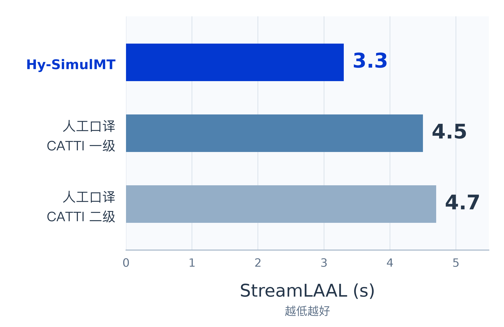

[English](README.md) | **简体中文**
<p align="center">
  
</p>

<h1 align="center">
   <sub></sub> Hy-SimulMT
</h1>

<p align="center"><b>低延迟、高质量的实时同声传译模型</b></p>

<div align="center">

[](https://huggingface.co/collections/tencent/hy-simulmt)
[](https://www.modelscope.cn/collections/Tencent-Hunyuan/Hy-SimulMT)
[](https://github.com/Tencent-Hunyuan/Hy-SimulMT)

</div>

## 模型介绍

**Hy-SimulMT** 是腾讯混元推出的实时同声传译大模型，支持**中文与英文之间的双向语音到语音翻译**。说话人的音频可以持续输入，模型边听边译，同步给出译文文字与语音，并支持**实时音色克隆**，在准确传达信息的同时保留说话人的声音特点。

面向会议、演讲与访谈等实时交流场景，Hy-SimulMT 希望在准确传达信息的同时，减少等待对交流节奏的影响。围绕这一目标，我们结合公开基准测试、真实场景音频和专业同传译员对照，评估模型在翻译质量与响应速度之间的平衡。

在本次 **RealSI 长音频评测**中，Hy-SimulMT 的 **StreamLAAL 约为 3 秒**，为图示参评系统中的最低值；GEMBA 得分高于所对比的开源模型，并超过五个商业 API 中的四个。

本仓库提供配套的 **SimulInfer 推理服务**与 **SimulTrain 训练工具**，其中语音输出与音色克隆需配置 TTS 服务。也欢迎在 **Hy 翻译 App** 中体验 Hy-SimulMT。

<p align="center"><b>扫码下载 Hy 翻译 App</b></p>
<table align="center">
  <tr>
    <th align="center">Android</th>
    <th align="center">iOS</th>
  </tr>
  <tr>
    <td align="center"></td>
    <td align="center"></td>
  </tr>
</table>

## 新闻

- **2026.10.26｜发布**：Hy-SimulMT发布，支持中英双向实时同声传译与实时音色克隆，项目及模型资源入口见下方链接。


## 效果

### 更快跟上，也更准确地传达

同声传译的挑战，不只是把一种语言变成另一种语言，而是在说话仍在继续时，及时理解并组织译文。等待更多信息，通常有助于判断完整语义，却也会拉长听众的等待；更早开口，则对增量理解与译文组织提出了更高要求。

Hy-SimulMT 关注的，正是这一质量与延迟之间的平衡：**在持续输入的语音流中边听边译，让听众及时获得信息，同时尽可能准确地传达原意。**

我们在开源 RealSI 长音频测试集上，对比了多个开源同传模型与商业同传 API。结果显示，Hy-SimulMT 在更低的延迟下，取得了具有竞争力的翻译质量。

<div align="center">
  
</div>

*横轴为 StreamLAAL，衡量流式翻译的滞后程度，单位为秒，越低越好；纵轴为 GEMBA 翻译质量评分，越高越好。StreamLAAL 不等同于首次开口延迟。*

在本次评测中，Hy-SimulMT 的 **StreamLAAL 约为 3 秒**，为图示参评系统中的最低值；GEMBA 得分高于所对比的开源模型，并超过五个商业 API 中的四个。

这意味着，低延迟并不必然以明显牺牲翻译质量为代价。Hy-SimulMT 为持续演讲、访谈与会议交流提供了更及时的跨语言信息获取方式。

### 从公开基准，走向真实场景

#### 多个短音频测试集上的质量表现

除长音频外，我们还在 FLEURS、CoVoST2、ACL6060 和 RealSI-Sentence 四个公开短音频测试集上进行了评测，观察模型在不同数据条件下的翻译表现。

| API / Model | FLEURS | CoVoST2 | ACL6060 | RealSI-Sentence |
| --- | ---: | ---: | ---: | ---: |
| Qwen3.8-LiveTranslate | 88.4 | **82.1** | 80.5 | 84.4 |
| **Hy-SimulMT** | **90.3** | **75.5** | **81.2** | **84.7** |
| Gemini3.5-LiveTranslate | **92.4** | 74.4 | **82.6** | 82.2 |
| Confucius4 R2T2 → T3PO | 89.4 | 76.8 | 76.1 | 77.7 |
| Seed-LiveInterpret2.0 | 85.8 | 67.7 | 74.8 | 80.0 |
| SimulS2ST-Omni | 78.6 | 66.6 | 73.1 | 77.4 |
| GPT-Realtime-Translate | 77.7 | 50.8 | 76.4 | 76.7 |
| XunFei-Simult-Interpretation | 73.4 | 57.0 | 57.5 | 70.9 |
| SeamlessStreaming | 72.8 | 60.9 | 49.8 | 56.9 |

*分数越高越好；Hy-SimulMT 整行加粗用于突出本模型，其余加粗数值为对应列最高分。*

Hy-SimulMT 在 FLEURS、ACL6060 和 RealSI-Sentence 三个测试集上的得分，均高于表中其他开源模型；其中，RealSI-Sentence 得分为 **84.7**，是表列参评系统中的最高分。不同测试集的结果，也帮助我们持续识别模型的优势与改进方向。

#### 与专业同传译员进行同场对照

为进一步观察模型在真实内容中的表现，我们收集了 **2026 年 9 月以后新出现于互联网的 18 段中文与英文音频，每段约 6 分钟**，覆盖演讲、访谈、会议等场景，以及软件与 AI、医学、制造与能源、自然科学、农业与食品、商务管理、法律、教育、文化文旅、体育生活十个领域。

除测试 Hy-SimulMT 外，我们还邀请了六位拥有多年同传实战经验的译员，分别对这些音频进行同声传译：其中三位持有 CATTI 一级口译证书，三位持有 CATTI 二级口译证书。每个等级均选取三位译员中的最高分进行对照。

<div align="center">
  
</div>

可以看到，在这次小范围的能力定位测评中，Hy-SimulMT在翻译的质量达到人类同传专家水平，不过速度往往更快（时延更低）。

*以上结论仅适用于本次样本、参测译员及评测设置，不代表对播报音质、音色相似度等维度的综合评价。*

##### 与人工同传的对比示例

除了量化指标，也可以通过以下四段对比视频，直观体验 Hy-SimulMT 与人工同传在信息传达、响应节奏和译语表达上的表现。

点击播放器右下角的**全屏按钮**，或点击下方的**观看大视频**链接，即可放大观看。

<table>
  <tr>
    <td align="center" width="50%">
      <p><b>对比示例 1</b></p>
      <video src="https://github.com/user-attachments/assets/7822209c-5124-41ee-856f-e00e9073a445" width="380" controls></video>
      <p>
        <a href="https://github.com/user-attachments/assets/7822209c-5124-41ee-856f-e00e9073a445">观看大视频 · 31 秒</a>
      </p>
    </td>
    <td align="center" width="50%">
      <p><b>对比示例 2</b></p>
      <video src="https://github.com/user-attachments/assets/78b0fed6-dc3b-41e8-9345-18f10480a7b2" width="380" controls></video>
      <p>
        <a href="https://github.com/user-attachments/assets/78b0fed6-dc3b-41e8-9345-18f10480a7b2">观看大视频 · 38 秒</a>
      </p>
    </td>
  </tr>
  <tr>
    <td align="center" width="50%">
      <p><b>对比示例 3</b></p>
      <video src="https://github.com/user-attachments/assets/07ebf679-2e78-4864-b007-fbd1ec802ca0" width="380" controls></video>
      <p>
        <a href="https://github.com/user-attachments/assets/07ebf679-2e78-4864-b007-fbd1ec802ca0">观看大视频 · 26 秒</a>
      </p>
    </td>
    <td align="center" width="50%">
      <p><b>对比示例 4</b></p>
      <video src="https://github.com/user-attachments/assets/ec690659-eb8d-44f9-a6ea-f5f2d100a330" width="380" controls></video>
      <p>
        <a href="https://github.com/user-attachments/assets/ec690659-eb8d-44f9-a6ea-f5f2d100a330">观看大视频 · 37 秒</a>
      </p>
    </td>
  </tr>
</table>

## 不只翻译文字，也保留声音特点

跨语言交流不仅承载信息，也包含说话人的声音特点。Hy-SimulMT 支持实时音色克隆，在生成目标语言语音的同时，保留原说话人的音色特征。

在英文到中文的演示中，输入包含三位说话人，模型能够分别呈现不同说话人的音色特点，让听众在获取译文的同时，更容易区分“谁在说话”。

### 英文 → 中文实时同传与音色克隆

https://github.com/user-attachments/assets/a2cb6da1-6a35-44d8-ac52-8a92bfa450df

[观看英文 → 中文演示（1 分 39 秒）](assets/en_zh_simultaneous_translation.mp4)

### 中文 → 英文实时同传与音色克隆

https://github.com/user-attachments/assets/466a64c2-787b-4ade-8f22-576a2d31edac

[观看中文 → 英文演示（35 秒）](assets/videos/zh_en_simultaneous_translation.mp4)

从跨语言演讲到多人访谈，这一能力为更自然、更易辨识的语音交流提供了新的可能。

## 在真实反馈中持续打磨

同声传译最终要服务真实沟通。除了基准分数，我们同样重视专业译员对信息传达、响应节奏与译语听感的反馈。

> 广外高翻学院副院长王巍巍表示，"在实际场景测评中，腾讯混元同声传译的译语听感自然，常规陈述的主干信息传达准确。为控制延迟，系统先开口、后修补，修补的听感接近译员的自我修正。这标志着国产AI同传（自动语音翻译，AST）能力迈上了新的台阶。随着技术的持续打磨，AI同传正从“辅助理解”走向低风险场景“可用沟通”，为推动人机协同的翻译新范式提供了重要的技术支撑。"

> 广东外语外贸大学原校长、中国澳门中西创新学院校长、中国翻译协会原常务副会长、口译专业委员会主任委员 仲伟合教授表示，"同声传译是语言服务中最具挑战性的领域。通过系统测评，腾讯混元同传大模型在语音识别稳定性、同传响应速度与译语播报质量上均展现出不俗的实力，其研发成果体现出AI同传技术持续向好的进步态势，为推动机器同传走进真实场景提供了有力的技术支撑。"

这些反馈也指向了清晰的应用方向：让 AI 同传先在适合的低风险场景中提供帮助，并在人机协同中持续完善。对于需要严格责任判断、专业审校或高风险决策的场景，专业译员的参与仍然重要。

## 模型链接

| 模型名 | 简介 | 下载链接 |
| --- | --- | --- |
| Hy-SimulMT-30B-A3B | 混元同声传译模型，仅输出译文 | [Model](https://huggingface.co/tencent/Hy-SimulMT-30B-A3B) |
| Hy-SimulMT-30B-A3B-FP8 | 混元同声传译模型，仅输出译文，FP8 量化 | [Model](https://huggingface.co/tencent/Hy-SimulMT-30B-A3B-FP8) |
| Hy-SimulMT-30B-A3B-GGUF | 混元同声传译模型，仅输出译文，GGUF 格式 | [Model](https://huggingface.co/tencent/Hy-SimulMT-30B-A3B-GGUF) |
| Hy-SimulMT-30B-A3B-Interleave | 混元同声传译模型，输出原文与译文 | [Model](https://huggingface.co/tencent/Hy-SimulMT-30B-A3B-Interleave) |
| Hy-SimulMT-30B-A3B-Interleave-FP8 | 混元同声传译模型，输出原文与译文，FP8 量化 | [Model](https://huggingface.co/tencent/Hy-SimulMT-30B-A3B-Interleave-FP8) |
| Hy-SimulMT-30B-A3B-Interleave-GGUF | 混元同声传译模型，输出原文与译文，GGUF 格式 | [Model](https://huggingface.co/tencent/Hy-SimulMT-30B-A3B-Interleave-GGUF) |

模型集合：[Hugging Face](https://huggingface.co/collections/tencent/hy-simulmt) ｜ [ModelScope](https://www.modelscope.cn/collections/Tencent-Hunyuan/Hy-SimulMT)。

可在 **Hy 翻译 App** 中体验 Hy-SimulMT，下载二维码见上方[模型介绍](#模型介绍)。

从“听得懂”到“跟得上”，再到更自然的语音表达，Hy-SimulMT 希望让跨语言交流减少等待，让信息更顺畅地抵达听众。

---

## 部署推理服务

> **可以参考 [SimulInfer README](SimulInfer/README.zh-CN.md) 逐步安装，也可以使用下方的一键部署命令。** 带 `--install-server` 的一键部署会在独立部署环境中安装依赖；再次运行会重新执行安装步骤，可能重新安装 SimulInfer 或调整这些环境中的依赖版本。如果已有定制的 vLLM/CUDA 环境，或需要自行控制依赖版本，建议按详细指南逐步安装，或使用下方的**“已有兼容的 vLLM 环境”**方式。

**SimulInfer** 支持网页、音频文件上传、实时 WebSocket，以及可选的 TTS 输入音色克隆。
页面根据部署的模型自动显示源文或仅显示译文，无需再选择输出模式。

### vLLM

准备 Linux、Python 3.12 及以上、Git、能够容纳所选模型的 NVIDIA GPU 和兼容的驱动。
使用已有模型环境时，需要 vLLM ≥0.31、支持 `HYV3ForCausalLM`，并安装 `simulst`。

获取项目后进入推理目录，以下部署命令均在 `SimulInfer/` 中执行：

```bash
git clone https://github.com/Tencent-Hunyuan/Hy-SimulMT.git Hy-SimulMT
cd Hy-SimulMT
cd SimulInfer
```

**新环境：一条命令安装依赖并启动模型和网页服务。**

```bash
bash deploy.sh --install-server --model tencent/Hy-SimulMT-30B-A3B-Interleave
```

使用已有本地模型时，将模型 ID 换成目录：

```bash
bash deploy.sh --install-server --model /path/to/Hy-SimulMT-30B-A3B-Interleave
```

命令会创建独立环境、安装依赖、准备模型，依次启动 vLLM 和网页/API 服务。
首次运行需要下载依赖；使用 Hugging Face ID 时还会下载模型。启动后保持命令运行。

**已有兼容的 vLLM 环境：**

```bash
/path/to/model-env/bin/python -m pip install --no-deps simulst
bash deploy.sh --server-python /path/to/model-env/bin/python --model /path/to/model
```

这种方式使用现有模型环境，并单独创建网页服务环境。定制 vLLM 或 CUDA 构建请选择此方式。

**模型 API 已经启动：**

```bash
bash deploy.sh --backend-url http://model-host:8800/v1
```

此时只启动 SimulInfer。已有模型需要准备推理模板时，按[模型部署说明](SimulInfer/README.zh-CN.md#手动部署模型)操作。

#### 打开并使用

看到 `Ready: http://127.0.0.1:8080/` 后，在服务器浏览器打开该地址；
其他机器访问 `http://SERVER_IP:8080/`。选择翻译方向，上传音频或开启麦克风，
说话结束后点击“结束并收尾”。远程使用麦克风需要 HTTPS，可使用平台提供的 HTTPS
端口转发地址，并保留 `/proxy/8080/` 等完整路径。

命令行上传文件：

```bash
curl -N http://127.0.0.1:8080/translate/stream \
  -F direction=en-zh -F file=@audio.wav
```

或者在另一个终端进入 `Hy-SimulMT/SimulInfer/`，使用已安装的客户端：

```bash
.simulinfer/app-env/bin/simulinfer-client audio.wav --url http://127.0.0.1:8080
```

部署配置开启 TTS 后，同一命令也会把返回的语音保存为 `outputs/translated.wav`。
交互式 API 文档位于 `/docs`。

#### 配置与停止

默认网页/API 端口为 **8080**，本机模型端口为 **8800**。
环境、生成的 `config.toml` 和日志保存在 `SimulInfer/.simulinfer/`；网页日志为 `app.log`，
启动模型时还会生成 `model.log`。按 **Ctrl+C** 停止这条命令启动的服务。
端口被占用时会报错，可通过 `--port` 或 `--model-port` 选择其他端口。

需要保存配置时：

```bash
cp deploy.example.toml deploy.toml
# 修改模型、GPU、端口以及可选的 TTS 服务地址。
bash deploy.sh --config deploy.toml
```

常用启动方式：

```bash
bash deploy.sh --install-server --model /path/to/model --gpus 0
bash deploy.sh --install-server --model /path/to/model --gpus 0,1 --tensor-parallel-size 2
bash deploy.sh --backend-url http://model-host:8800/v1 --port 8081 --runtime-dir .simulinfer-alt
```

如果 `python3` 不是所需版本，可在命令前加 `SIMULINFER_PYTHON=python3.12`。
下次使用相同部署命令即可再次启动。
更多内容见[详细推理指南](SimulInfer/README.zh-CN.md)、[配置说明](SimulInfer/docs/CONFIGURATION.md)、
[音频客户端](SimulInfer/docs/AUDIO_INPUT.en.md)和[TTS 部署](SimulInfer/docs/TTS.zh-CN.md)。

### llama.cpp

我们已为 llama.cpp 添加 Hy-SimulMT 的专用架构支持，以实现 GGUF 模型推理，并向 llama.cpp 官方仓库提交了 [PR #31198](https://github.com/ggml-org/llama.cpp/pull/31198)。

> 相关支持尚未合并至 llama.cpp 官方仓库。该 PR 当前支持通过 `llama-mtmd-cli` 进行推理，`llama-server` 支持将在后续适配。使用下方服务部署步骤前，请确认所用 llama.cpp 版本已具备 Hy-SimulMT 所需的服务端支持。

前提：支持音频输入的 llama.cpp 服务已在 **8080** 端口加载你的 Hy-SimulMT GGUF 模型。
在 Python 3.11 及以上环境中，从仓库根目录执行：

```bash
cd SimulInfer
python -m pip install .
export MODEL=/path/to/hymt-A3b-tgt_only-1019-Q8_0.gguf
MODEL_TYPE=target_only python serve_llamacpp.py
```

将 `MODEL` 替换为你自己的 GGUF 模型路径，必须与 llama.cpp 服务加载的路径一致。
仅译文模型使用 `MODEL_TYPE=target_only`；源文和译文同出的模型使用 `source_target`。

通过 `serve_llamacpp.py` 启动时，网页打开 **http://127.0.0.1:8094/**。
**8094** 是桥接网页/API端口，**8080** 是其连接的 llama.cpp 模型端口。
另一条 `deploy.sh` / `simulinfer` 启动路径默认使用 **8080** 作为网页/API端口。
文件上传和 WebSocket 接口分别为网页端口下的
`/translate/stream` 和 `/translate/ws`。脚本默认连接 `http://127.0.0.1:8080`；
模型服务在其他地址时设置 `LLAMA_URL`，网页/API 需要其他端口时设置 `PORT`。
远程使用麦克风时，通过 HTTPS 端口转发地址访问。

## 训练 — SimulTrain

**SimulTrain** 基于下载的 Hy-SimulMT checkpoint 继续训练。
模型路径、数据、GPU 和输出目录在 `SimulTrain/.env` 中配置。

从仓库根目录进入训练目录：

```bash
cd SimulTrain
```

环境准备、数据格式与训练命令见[训练指南](SimulTrain/README.zh-CN.md)或[English](SimulTrain/README.md)。
训练请使用独立 Python 环境。

## 贡献者

Mao Zheng, Bo Lv, Mingrui Sun, Zheng Li, Fangxu Liu, Tao Chen, Bingxin Qu, Shan Yang, rickkan, Guanghua Yu, Decheng Wu, Hongyu Li, Steve Yves

## Citing Hy-SimulMT

如果 Hy-SimulMT 对你有所帮助，欢迎引用：

```bibtex
@misc{hy_simulmt,
  title  = {Hy-SimulMT：A Low-Latency, High-Quality Model for Real-Time Simultaneous Translation},
  author = {Mao Zheng and Bo Lv and Mingrui Sun and Zheng Li and Fangxu Liu and Tao Chen and Bingxin Qu},
  year   = {2026},
  month  = oct,
  url    = {https://hy.tencent.com/model/open-source-model/detail?id=hy-simulmt}
}
```

## 联系我们

如果你想给我们的研发和产品团队留言，欢迎联系我们腾讯混元 LLM 团队。你可以通过邮件 [hunyuan_opensource@tencent.com](mailto:hunyuan_opensource@tencent.com) 联系我们。
